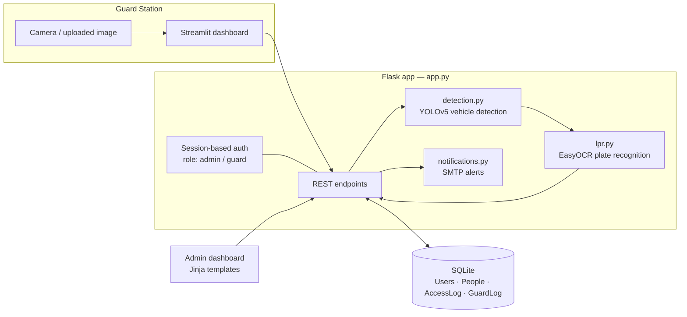

# SCAE — Vehicular Access Control System

[](https://www.python.org/)
[](https://flask.palletsprojects.com/)
[-purple)](https://github.com/ultralytics/ultralytics)
[](LICENSE)

A computer-vision access-control system for campus/facility vehicle gates. A guard-facing
web dashboard captures a vehicle image, the backend detects the vehicle and reads its license
plate, cross-references it against a roster of authorized people, and logs every allow/deny
decision — with role-based dashboards for guards and administrators and email alerts on
infractions.

Built as a systems project spanning computer vision, a REST-ish Flask backend, and a
separate Streamlit client — three moving parts that have to agree on a contract.

## Features

- **Vehicle detection** — YOLOv5 (via the `ultralytics` package) locates vehicles in an
  uploaded frame.
- **License-plate recognition (LPR)** — EasyOCR reads the plate out of the detected
  vehicle's bounding box.
- **Access decisioning** — recognized plates are matched against a `Person` roster; guards
  can allow, deny, or flag an infraction, all logged with a timestamp and the guard on duty.
- **Role-based dashboards** — separate guard and admin views (Flask-rendered pages) plus a
  Streamlit client that talks to the same backend over its JSON API.
- **Admin console** — add/remove guards, reassign gates, and review the full access-log and
  guard sign-in/sign-out history.
- **Email notifications** — SMTP alert sent when an infraction is issued.

## Architecture



**Request flow for a gate check:** the guard uploads a frame → `detection.py` runs YOLOv5 to
find vehicle bounding boxes → each crop goes to `lpr.py` for OCR → a recognized plate is looked
up in the `Person` table → the guard allows, denies, or flags the visit, which writes an
`AccessLog` row and (for infractions) triggers an email via `notifications.py`.

## Tech stack

| Layer | Technology |
|---|---|
| Detection | YOLOv5 (Ultralytics) |
| OCR | EasyOCR |
| Backend | Flask, Flask-SQLAlchemy |
| Guard/admin client | Streamlit |
| Database | SQLite (swappable via `DATABASE_URL`) |
| Auth | Server-side sessions, password hashing via Werkzeug |
| Notifications | SMTP |

## Project structure

```
scae-vehicular-access-control/
├── app.py              # Flask app: routes, auth, seed data
├── db_models.py         # SQLAlchemy models: User, Person, AccessLog, GuardLog
├── detection.py          # YOLOv5 vehicle detection
├── lpr.py                # EasyOCR license-plate recognition
├── camera.py             # Video-file frame generator (for a live camera feed)
├── notifications.py      # SMTP infraction alerts
├── dashboard/
│   └── dashboard.py      # Streamlit guard/admin client
├── templates/             # Flask-rendered pages (login, admin, guard, logs)
├── requirements.txt
└── .env.example
```

## Quick start

```bash
git clone https://github.com/TheBlackDie901/SCAE.git
cd SCAE
python -m venv venv && source venv/bin/activate   # Windows: venv\Scripts\activate
pip install -r requirements.txt
cp .env.example .env   # fill in FLASK_SECRET_KEY and, if you want email alerts, SMTP_*

# Terminal 1 — backend (creates & seeds the SQLite DB on first run)
python app.py

# Terminal 2 — guard/admin dashboard
streamlit run dashboard/dashboard.py
```

The first run of `detection.py` downloads the YOLOv5 weights automatically (~90 MB) via
`ultralytics`; an internet connection is needed once.

**Demo accounts** (seeded automatically): `admin` / `admin123`, `guard1` / `pass1`, `guard2` / `pass2`.
Change these before any real deployment.

## Known limitations

- Infraction emails are sent to a placeholder address (`person@example.com`) — the `Person`
  model has no email field yet, so this needs a schema addition to be wired up for real use.
- LPR uses a length-based heuristic (5–10 characters) to pick the most plate-like OCR result
  rather than a trained plate-detection model — works well enough for demo images, less
  robust against noisy backgrounds.
- No automated tests yet (see Roadmap).

## Roadmap

- [ ] Add an `email` field to `Person` and wire real infraction notifications
- [ ] Swap the OCR length heuristic for a dedicated plate-detector + OCR two-stage pipeline
- [ ] Add pytest coverage for the access-decision logic
- [ ] Containerize (Dockerfile + docker-compose for backend + dashboard together)
- [ ] Live camera feed via `camera.py` instead of manual image upload

## License

MIT — see [LICENSE](LICENSE).
